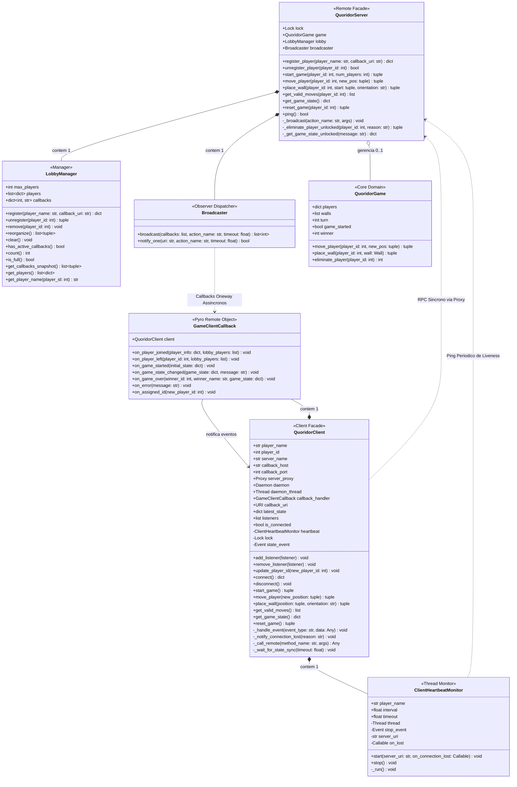

# Diagrama de Classes: Módulo de Rede (`network`)

Este documento apresenta o modelo orientado a objetos do pacote de rede (`network/`) do **Quoridor Multiplayer**, detalhando suas classes, atributos, métodos, visibilidade e os relacionamentos estruturais e distribuídos que conectam os clientes e o servidor Pyro5.

---

## 1. Diagrama de Classes UML (Mermaid)

---

## 2. Detalhamento das Classes

### 2.1. [`QuoridorServer`](file:///c:/Users/lferr/Documents/quoridor/network/server.py#L30) (Fachada Remota do Servidor)

* **Arquivo:** [`network/server.py`](file:///c:/Users/lferr/Documents/quoridor/network/server.py)
* **Padrão de Projeto:** Remote Facade, Singleton Remoto (`instance_mode="single"`).
* **Decoradores Pyro:** `@Pyro5.api.expose`, `@Pyro5.api.behavior(instance_mode="single")`.

| Atributo | Tipo | Visibilidade | Descrição |
| :--- | :--- | :--- | :--- |
| `lock` | `threading.Lock` | Público | Garante exclusão mútua e sincronização de concorrência entre threads do Pyro. |
| `game` | `QuoridorGame \| None` | Público | Instância das regras de negócio do Quoridor ativo na partida atual. |
| `lobby` | `LobbyManager` | Público | Componente responsável pelo gerenciamento de participantes e fila de espera. |
| `broadcaster` | `Broadcaster` | Público | Componente responsável pela difusão de callbacks assíncronos para os clientes. |

| Método | Retorno | Visibilidade | Descrição |
| :--- | :--- | :--- | :--- |
| `register_player(player_name, callback_uri)` | `dict[str, Any]` | Público (RPC) | Valida entrada, aloca ID no lobby, registra URI do cliente e despacha evento. |
| `unregister_player(player_id)` | `bool` | Público (RPC) | Desregistra o cliente quando ele sai voluntariamente do jogo. |
| `start_game(player_id, num_players)` | `tuple[bool, str]` | Público (RPC) | Inicia a partida caso o requisitante seja o Host (P1) e haja jogadores suficientes. |
| `move_player(player_id, new_pos)` | `tuple[bool, str]` | Público (RPC) | Valida a vez do jogador e aplica o movimento do peão nas regras. |
| `place_wall(player_id, start, orientation)` | `tuple[bool, str]` | Público (RPC) | Valida regras de bloqueio e posiciona uma barreira no tabuleiro. |
| `get_valid_moves(player_id)` | `list[tuple[int, int]]` | Público (RPC) | Retorna coordenadas acessíveis para o peão no turno corrente. |
| `get_game_state()` | `dict[str, Any]` | Público (RPC) | Retorna snapshot do estado serializado da partida. |
| `reset_game(player_id)` | `tuple[bool, str]` | Público (RPC) | Reseta a partida para reiniciar com os mesmos jogadores no lobby. |
| `ping()` | `bool` | Público (RPC) | Endpoint ultraleve de liveness para verificação de disponibilidade via Heartbeat. |
| `_broadcast(action_name, *args, **kwargs)` | `void` | Privado | Dispara notificação via `Broadcaster` e trata eliminação de clientes mortos. |
| `_eliminate_player_unlocked(player_id, reason)` | `tuple` | Privado | Remove jogador inativo e verifica se há vitória por W.O. ou avança o turno. |
| `_get_game_state_unlocked(message)` | `dict[str, Any]` | Privado | Serializa o estado atual sem readquirir o Lock de instância. |

---

### 2.2. [`LobbyManager`](file:///c:/Users/lferr/Documents/quoridor/network/lobby.py#L8) (Gerenciador da Sala de Espera)

* **Arquivo:** [`network/lobby.py`](file:///c:/Users/lferr/Documents/quoridor/network/lobby.py)
* **Padrão de Projeto:** Manager / Information Expert.
* **Propósito:** Isolar a regra de indexação de IDs sequenciais (1..N) e mapeamento de URIs de callback.

| Atributo | Tipo | Visibilidade | Descrição |
| :--- | :--- | :--- | :--- |
| `max_players` | `int` | Público | Limite máximo configurado para a sala (padrão: 4). |
| `players` | `list[dict[str, Any]]` | Público | Lista ordenada dos jogadores contendo `id`, `name` e `callback_uri`. |
| `callbacks` | `dict[int, str]` | Público | Dicionário chaveado por `player_id` mapeando a URI Pyro5 correspondente. |

| Método | Retorno | Visibilidade | Descrição |
| :--- | :--- | :--- | :--- |
| `register(player_name, callback_uri)` | `dict[str, Any]` | Público | Aloca o menor ID numérico disponível e armazena os dados do cliente. |
| `unregister(player_id)` | `tuple[bool, str]` | Público | Remove o jogador e devolve tupla de status e nome removido. |
| `remove(player_id)` | `void` | Público | Exclusão direta de jogador e callback sem lançamento de exceção. |
| `reorganize()` | `list[tuple[str, int]]` | Público | Reordena sequencialmente os IDs de 1 a N após saídas e retorna atualizações. |
| `clear()` | `void` | Público | Esvazia listas de jogadores e callbacks. |
| `has_active_callbacks()` | `bool` | Público | Verifica se ainda resta algum cliente ativo conectado. |
| `count()` | `int` | Público | Retorna o total numérico de participantes presentes. |
| `is_full()` | `bool` | Público | Indica se a capacidade máxima foi atingida. |
| `get_callbacks_snapshot()` | `list[tuple[int, str]]` | Público | Fornece cópia segura da lista de callbacks para iteração sem travas. |
| `get_players()` | `list[dict[str, Any]]` | Público | Retorna cópia rasa da lista de participantes. |
| `get_player_name(player_id)` | `str` | Público | Recupera o nome cadastrado ou nome padrão formatado. |

---

### 2.3. [`Broadcaster`](file:///c:/Users/lferr/Documents/quoridor/network/broadcaster.py#L10) (Despachante de Eventos Assíncronos)

* **Arquivo:** [`network/broadcaster.py`](file:///c:/Users/lferr/Documents/quoridor/network/broadcaster.py)
* **Padrão de Projeto:** Distributed Observer / Publisher-Subscriber.
* **Propósito:** Isolar a criação de proxies Pyro5 temporários para despachos remotos não-bloqueantes.

| Método | Retorno | Visibilidade | Descrição |
| :--- | :--- | :--- | :--- |
| `broadcast(callbacks, action_name, *args, timeout, **kwargs)` | `list[int]` | Estático / Público | Itera sobre a lista de callbacks, invoca métodos `oneway` e retorna IDs dos clientes que falharam (`dead_players`). |
| `notify_one(uri, action_name, *args, timeout, **kwargs)` | `bool` | Estático / Público | Envia notificação direcionada a um único cliente (ex: sincronização de novo ID). |

---

### 2.4. [`QuoridorClient`](file:///c:/Users/lferr/Documents/quoridor/network/client.py#L23) (Fachada do Cliente)

* **Arquivo:** [`network/client.py`](file:///c:/Users/lferr/Documents/quoridor/network/client.py)
* **Padrão de Projeto:** Client Facade, Local Subject / Observable.
* **Propósito:** Ponto central de comunicação da interface gráfica (Pygame) ou CLI com a rede.

| Atributo | Tipo | Visibilidade | Descrição |
| :--- | :--- | :--- | :--- |
| `player_name` | `str` | Público | Nome do jogador local. |
| `player_id` | `int \| None` | Público | ID atribuído pelo servidor (1 a 4). |
| `server_proxy` | `Pyro5.api.Proxy \| None` | Público | Proxy de chamadas RPC síncronas para o servidor. |
| `daemon` | `Pyro5.api.Daemon \| None` | Público | Daemon local do Pyro5 para escuta de callbacks reversos. |
| `callback_handler` | `GameClientCallback` | Público | Instância receptora registrada no daemon local. |
| `callback_uri` | `Pyro5.api.URI \| None` | Público | URI publicada pelo daemon do cliente enviada ao servidor. |
| `latest_state` | `dict[str, Any]` | Público | Cache local sincronizado do estado do tabuleiro e lobby. |
| `listeners` | `list[Callable]` | Público | Lista de ouvintes locais (GUI Pygame / Terminal CLI). |
| `is_connected` | `bool` | Público | Flag de estado da conexão. |
| `heartbeat` | `ClientHeartbeatMonitor` | Privado | Thread de segundo plano responsável por monitorar o servidor. |
| `lock` | `threading.Lock` | Privado | Sincroniza acesso concorrente entre a thread da GUI e callbacks. |
| `state_event` | `threading.Event` | Privado | Sinaliza a chegada de atualização de estado após uma ação local. |

| Método | Retorno | Visibilidade | Descrição |
| :--- | :--- | :--- | :--- |
| `connect()` | `dict[str, Any]` | Público | Sobe o Daemon local, localiza o servidor no Name Server e registra o jogador. |
| `disconnect()` | `void` | Público | Para o heartbeat, encerra o Daemon local e notifica o servidor. |
| `add_listener(listener)` | `void` | Público | Inscreve a interface de usuário para receber eventos despachados. |
| `remove_listener(listener)` | `void` | Público | Remove a inscrição do ouvinte de eventos. |
| `update_player_id(new_id)` | `void` | Público | Atualiza thread-safe o ID local quando reordenado pelo servidor. |
| `start_game()` | `tuple[bool, str]` | Público | Solicita o início da partida ao servidor via RPC. |
| `move_player(new_pos)` | `tuple[bool, str]` | Público | Executa movimentação do peão via RPC. |
| `place_wall(pos, orientation)` | `tuple[bool, str]` | Público | Posiciona barreira via RPC. |
| `get_valid_moves()` | `list[tuple[int, int]]` | Público | Consulta movimentos permitidos para o peão no turno corrente. |
| `get_game_state()` | `dict[str, Any]` | Público | Retorna cópia do estado local mais recente. |
| `reset_game()` | `tuple[bool, str]` | Público | Solicita reinício da partida. |
| `_handle_event(event_type, data)` | `void` | Privado | Despacha eventos recebidos do Pyro para os ouvintes registrados (Pygame/CLI). |
| `_notify_connection_lost(reason)` | `void` | Privado | Dispara evento `"connection_lost"` caso o servidor fique inacessível. |
| `_call_remote(method_name, *args)` | `Any` | Privado | Encapsula chamadas RPC no proxy com captura e tratamento de exceções de socket. |

---

### 2.5. [`GameClientCallback`](file:///c:/Users/lferr/Documents/quoridor/network/client_callback.py#L14) (Receptor Remoto do Cliente)

* **Arquivo:** [`network/client_callback.py`](file:///c:/Users/lferr/Documents/quoridor/network/client_callback.py)
* **Padrão de Projeto:** Remote Observer / Distributed Callback.
* **Decoradores Pyro:** `@Pyro5.api.expose`, `@Pyro5.api.oneway` em todos os métodos.

| Método | Retorno | Visibilidade | Descrição |
| :--- | :--- | :--- | :--- |
| `on_player_joined(player_info, lobby)` | `void` | Público (Oneway) | Invocado pelo servidor quando um novo cliente entra na sala. |
| `on_player_left(player_id, lobby)` | `void` | Público (Oneway) | Invocado quando um participante se desconecta. |
| `on_game_started(initial_state)` | `void` | Público (Oneway) | Invocado para dar início à partida para todos os clientes. |
| `on_game_state_changed(state, msg)` | `void` | Público (Oneway) | Invocado a cada turno, movimento de peão ou barreira posicionada. |
| `on_game_over(winner_id, name, state)` | `void` | Público (Oneway) | Invocado quando há um vencedor normal ou vitória por W.O. |
| `on_error(message)` | `void` | Público (Oneway) | Invocado para repassar mensagens de erro aos clientes. |
| `on_assigned_id(new_player_id)` | `void` | Público (Oneway) | Invocado pelo servidor quando a sala reorganiza os IDs sequenciais. |

---

### 2.6. [`ClientHeartbeatMonitor`](file:///c:/Users/lferr/Documents/quoridor/network/heartbeat.py#L11) (Monitor Ativo de Conexão)

* **Arquivo:** [`network/heartbeat.py`](file:///c:/Users/lferr/Documents/quoridor/network/heartbeat.py)
* **Padrão de Projeto:** Active Probe / Heartbeat.
* **Propósito:** Detecção rápida e assíncrona da queda do servidor sem competir por sockets com a thread da GUI.

| Atributo | Tipo | Visibilidade | Descrição |
| :--- | :--- | :--- | :--- |
| `player_name` | `str` | Público | Identificador do jogador para nomenclatura de logs e thread. |
| `interval` | `float` | Público | Intervalo regular entre cada teste de liveness (padrão: 2.0s). |
| `timeout` | `float` | Público | Timeout de resposta do socket para o ping (padrão: 2.0s). |
| `_thread` | `threading.Thread \| None` | Privado | Thread secundária em modo daemon onde roda o loop de monitoramento. |
| `_stop_event` | `threading.Event` | Privado | Sinalizador para parada graciosa da thread. |
| `_server_uri` | `str \| None` | Privado | URI de destino do servidor monitorado. |
| `_on_lost` | `Callable[[str], None] \| None` | Privado | Callback local acionado caso o servidor deixe de responder. |

| Método | Retorno | Visibilidade | Descrição |
| :--- | :--- | :--- | :--- |
| `start(server_uri, on_lost)` | `void` | Público | Inicializa a thread de monitoramento em segundo plano. |
| `stop()` | `void` | Público | Sinaliza parada da thread e aguarda seu término com `join()`. |
| `_run()` | `void` | Privado | Loop contínuo que executa `proxy.ping()` a cada `interval` segundos. |

---

## 3. Relacionamentos e Multiplicidades

### 3.1. Relacionamentos Estruturais (Mesmo Processo)

1. **`QuoridorServer` *-- `LobbyManager` (Composição 1 : 1):**
   * O servidor cria e possui exclusivamente sua instância de `LobbyManager`. O ciclo de vida do lobby está inteiramente atrelado ao ciclo de vida do servidor.
2. **`QuoridorServer` *-- `Broadcaster` (Composição 1 : 1):**
   * O servidor cria e utiliza exclusivamente sua instância de `Broadcaster` para despachar todas as notificações para a rede.
3. **`QuoridorServer` o-- `QuoridorGame` (Agregação 0..1 : 1):**
   * O objeto de jogo só existe enquanto há uma partida em andamento (`game != None`). Quando a partida termina ou os jogadores voltam para o lobby, a referência é limpa (`game = None`).
4. **`QuoridorClient` *-- `GameClientCallback` (Composição 1 : 1):**
   * O cliente cria seu manipulador de callbacks e o vincula ao seu próprio Daemon local.
5. **`QuoridorClient` *-- `ClientHeartbeatMonitor` (Composição 1 : 1):**
   * O cliente instancia e controla o ciclo de vida da thread de heartbeat.
6. **`GameClientCallback` --> `QuoridorClient` (Associação 1 : 1):**
   * O manipulador de callbacks possui uma referência para a fachada `QuoridorClient` e repassa os eventos recebidos da rede através do método `client._handle_event(...)`.

### 3.2. Relacionamentos Distribuídos (Através da Rede / Pyro5)

1. **`QuoridorClient` ..> `QuoridorServer` (Dependência RPC Síncrona via Proxy):**
   * O cliente invoca métodos remotos no servidor (`register_player`, `move_player`, `place_wall`, etc.) esperando resposta síncrona.
2. **`Broadcaster` ..> `GameClientCallback` (Dependência RPC Assíncrona Oneway):**
   * O despachante do servidor conecta-se temporariamente ao URI do cliente e dispara métodos decorados com `@Pyro5.api.oneway` (`on_game_state_changed`, `on_game_over`, etc.), sem bloquear o servidor.
3. **`ClientHeartbeatMonitor` ..> `QuoridorServer` (Dependência de Monitoramento Ativo):**
   * A thread secundária do cliente conecta-se ao servidor a cada 2 segundos através de um proxy isolado chamando `proxy.ping()`. Se houver timeout ou socket fechado, aciona a rotina de desconexão no cliente.
