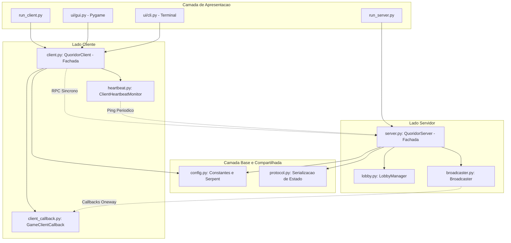

# Guia de Arquitetura: Módulo de Rede (`network`)

Este documento descreve detalhadamente a arquitetura, organização e responsabilidades dos módulos do pacote `network/` do Quoridor Multiplayer. Ele foi estruturado para servir como material de apoio técnico e roteiro prático para apresentação acadêmica do projeto.

> [!TIP]
> Para o modelo detalhado orientado a objetos com atributos, métodos e tipos UML, consulte o documento complementar [Diagrama de Classes do Módulo Network](file:///c:/Users/lferr/Documents/quoridor/docs/network_class_diagram.md).

---

## 1. Visão Geral e Motivação da Modularização

Antes da refatoração, a camada de rede concentrava toda a lógica do servidor em um único arquivo de ~700 linhas (`server.py`) e toda a lógica do cliente em ~520 linhas (`client.py`). Essa concentração gerava alto acoplamento entre regras de sessão, I/O de rede e regras do jogo.

A nova arquitetura adota o princípio de **Separação de Preocupações (*Separation of Concerns - SoC*)** e o padrão **Fachada Remota (*Remote Facade*)**, dividindo o pacote em **8 módulos especializados**:

---

## 2. Detalhamento dos Módulos

### 2.1. `network/config.py` — Configurações e Serializadores Serpent

* **Linhas de código**: ~80 linhas.
* **Propósito**: Centralizar constantes de rede, logging e registro de serializadores customizados para o Pyro5.
* **Principais Elementos**:
  * `DEFAULT_SERVER_NAME = "quoridor.servidor"`: Nome amigável registrado no Name Server.
  * `DEFAULT_NS_HOST`, `DEFAULT_NS_PORT`: Endereço padrão do Name Server Pyro5 (porta 9090).
  * `ALLOWED_PLAYER_COUNTS = (2, 4)`: Quantidade legal de participantes para partida.
  * `configure_pyro()`: Registra conversores bidirecionais entre as dataclasses do domínio (`Wall` e `Player`) e dicionários padrão serializáveis pela biblioteca **Serpent**. Executado de forma idempotente tanto no cliente quanto no servidor.

---

### 2.2. `network/protocol.py` — Protocolo de Aplicação e Estado

* **Linhas de código**: ~130 linhas.
* **Propósito**: Definir o formato serializável das mensagens e sincronizar o estado da partida entre nós da rede.
* **Principais Elementos**:
  * `serialize_game_state(game, lobby_players, status_message)`: Converte instâncias ativas de `QuoridorGame` e a lista de espera em um dicionário Python contendo apenas dados primitivos (turnos, paredes posicionadas, peões ativos e vencedores).
  * `sync_game_from_state(game, state)`: Reconstrói ou atualiza a instância local de `QuoridorGame` no cliente para renderização fiel pela interface gráfica ou texto.

---

### 2.3. `network/lobby.py` — Gerenciador de Sala de Espera (`LobbyManager`)

* **Linhas de código**: ~150 linhas.
* **Propósito**: Isolar toda a lógica de gerenciamento de participantes aguardando partida.
* **Responsabilidades**:
  * **Registro de Jogadores (`register`)**: Valida nomes, purga conexões órfãs e aloca o menor identificador sequencial disponível (de 1 a 4).
  * **Reorganização Dinâmica (`reorganize`)**: Quando um jogador desconecta, os IDs restantes são reindexados sequencialmente (ex: se o Jogador 1 sai, o Jogador 2 se torna Jogador 1 e novo host da sala). Retorna uma lista de atualizações para que o servidor notifique os clientes afetados via `on_assigned_id`.
  * **Controle de Capacidade**: Métodos `count()`, `is_full()`, `clear()` e `has_active_callbacks()`.
* **Vantagem para Apresentação**: Mostra que a complexidade de indexação de IDs e lista de presença não polui a lógica das regras do jogo.

---

### 2.4. `network/broadcaster.py` — Difusão de Notificações (`Broadcaster`)

* **Linhas de código**: ~90 linhas.
* **Propósito**: Implementar o padrão **Observer Distribuído** para envio de notificações assíncronas do servidor para os clientes conectados.
* **Responsabilidades**:
  * **Broadcast Resiliente (`broadcast`)**: Itera sobre os callbacks cadastrados e invoca métodos remotos decorados como `oneway` com timeout configurável de 3.0s.
  * **Detecção de Conexões Mortas**: Se a chamada RPC falhar (socket fechado, timeout ou queda de máquina), o cliente é inserido na lista de `dead_players` para tratamento no servidor.
  * **Notificação Direcionada (`notify_one`)**: Envia mensagem direta para um único cliente (utilizado para avisar sobre alteração de ID após reorganização do lobby).
* **Vantagem para Apresentação**: Demonstra como a aplicação lida com I/O não bloqueante e identifica falhas de rede sem congelar a thread de processamento principal.

---

### 2.5. `network/server.py` — Fachada Remota do Servidor (`QuoridorServer`)

* **Linhas de código**: ~370 linhas (reduzido de ~700).
* **Propósito**: Servir como o ponto único de entrada remoto exposto via Pyro5 (`@Pyro5.api.expose`) e orquestrar o jogo.
* **Responsabilidades**:
  * **Coordenação Central**: Delega o lobby para `LobbyManager` e as notificações para `Broadcaster`.
  * **Concorrência Segura**: Protege todas as ações de jogo e lobby com `threading.Lock()`.
  * **Regras de Eliminação (`_eliminate_player_unlocked`)**: Quando um cliente cai, remove-o da partida, avança o turno para o próximo ativo ou declara vitória imediata por W.O. caso reste apenas um jogador.
  * **Autorreset Automático**: Caso todos os jogadores se desconectem ou uma partida concluída receba novos jogadores, reinicia automaticamente para o estado inicial sem exigir reinício manual do processo.
  * **Liveness Endpoint (`ping`)**: Responde instantaneamente a testes de heartbeat dos clientes.
  * **Função de Inicialização (`start_server`)**: Localiza o Name Server ou instancia um Name Server embutido (`start_ns_loop`), cria o Daemon do Pyro e publica o serviço.

---

### 2.6. `network/client_callback.py` — Receptor Remoto do Cliente (`GameClientCallback`)

* **Linhas de código**: ~115 linhas.
* **Propósito**: Objeto remoto registrado no mini-Daemon local do cliente para receber eventos enviados pelo servidor.
* **Métodos Expostos (Todos com `@Pyro5.api.oneway`)**:
  * `on_player_joined`: Novo participante conectado ao lobby.
  * `on_player_left`: Participante desconectado.
  * `on_game_started`: Início da partida autorizado.
  * `on_game_state_changed`: Movimentação de peão, barreira posicionada ou troca de turno.
  * `on_game_over`: Fim de partida com declaração do vencedor.
  * `on_assigned_id`: Notificação de sincronização de novo ID local atribuído pelo servidor.
  * `on_error`: Mensagem de erro do servidor.

---

### 2.7. `network/heartbeat.py` — Monitor de Conexão (`ClientHeartbeatMonitor`)

* **Linhas de código**: ~90 linhas.
* **Propósito**: Garantir que o cliente detecte a queda do servidor de forma ativa e rápida.
* **Funcionamento**:
  * Roda em uma thread separada (`threading.Thread(daemon=True)`).
  * Cria um proxy Pyro5 dedicado com timeout reduzido de 2.0s para não competir por socket com a thread principal.
  * Envia pings periódicos a cada 2.0s (`proxy.ping()`).
  * Se o ping falhar (servidor caiu, rede interrompida), invoca o callback `on_connection_lost` que notifica a interface gráfica/terminal.

---

### 2.8. `network/client.py` — Fachada do Cliente (`QuoridorClient`)

* **Linhas de código**: ~270 linhas (reduzido de ~520).
* **Propósito**: Coordenar a conexão do jogador, a execução de jogadas e o despacho de eventos para a interface visual.
* **Responsabilidades**:
  * **Inicialização do Daemon Local**: Cria o Daemon do cliente em thread secundária para escutar os callbacks remotos.
  * **Proxy RPC do Servidor**: Mantém a referência remota ao servidor com timeout seguro de 2.5s.
  * **Padrão Observer Local**: Mantém lista de ouvintes (`add_listener`, `remove_listener`, `_handle_event`) para alimentar a GUI Pygame ou CLI Terminal de forma completamente desacoplada do Pyro.
  * **Chamadas de Ação**: Métodos amigáveis como `start_game()`, `move_player()`, `place_wall()`, `get_valid_moves()` e `reset_game()`.

---

## 3. Fluxos de Dados e Ciclo de Vida da Partida

### Fluxo 1: Conexão e Entrada no Lobby

1. Usuário roda `python run_client.py --name "Alice"`.
2. `QuoridorClient.connect()` instancia o Daemon local, registra `GameClientCallback` e obtém `callback_uri`.
3. Consulta o Name Server por `PYRONAME:quoridor.servidor`.
4. Invoca remotamente `server.register_player("Alice", callback_uri)`.
5. No servidor, `LobbyManager.register()` aloca o ID 1 para Alice e guarda seu callback.
6. O servidor aciona `Broadcaster.broadcast("on_player_joined", ...)` avisando todos os presentes.
7. O cliente inicia `ClientHeartbeatMonitor` em background.

### Fluxo 2: Movimentação de Peão

1. O jogador da vez clica em uma casa do tabuleiro na interface gráfica.
2. `QuoridorClient.move_player((r, c))` executa a chamada RPC no servidor.
3. No servidor, `QuoridorServer.move_player` adquire o Lock, valida o turno e aplica o movimento no `QuoridorGame`.
4. Se válido, o servidor gera o novo estado e aciona `Broadcaster.broadcast("on_game_state_changed", estado)`.
5. Todos os clientes recebem o callback de forma assíncrona (`oneway`) e atualizam suas telas.

### Fluxo 3: Desconexão e Vitória por W.O

1. O Jogador 2 fecha sua janela durante a partida.
2. O servidor tenta despachar uma notificação; o `Broadcaster` captura a falha e retorna o Jogador 2 como inativo.
3. `QuoridorServer._eliminate_player_unlocked` elimina o Jogador 2.
4. Como resta apenas o Jogador 1 ativo, `self.game.eliminate_player()` declara o Jogador 1 vencedor por W.O.
5. O servidor despacha `on_game_over` para o Jogador 1, que vê a tela de vitória.

### Fluxo 4: Queda do Servidor

1. O processo `run_server.py` é cancelado ou cai inesperadamente.
2. Em até 2 segundos, a thread `ClientHeartbeatMonitor` em cada cliente tenta executar `ping()` e recebe erro de socket.
3. O monitor aciona `client._notify_connection_lost()`.
4. A GUI Pygame recebe o evento, ativa `self.connection_lost = True` e exibe o modal de alerta em vermelho sobre a tela, permitindo saída limpa com a tecla `ESC`.

---

## 4. Roteiro Sugerido para Apresentação do Projeto

Ao apresentar o projeto para a banca ou professor, siga este roteiro de 4 etapas:

### 1ª Etapa: Arquitetura de Alto Nível

* Explique que o projeto utiliza **Pyro5 (Python Remote Objects)** com arquitetura **Cliente-Servidor com Callbacks Reversos**.
* Destaque que tanto o servidor quanto os clientes possuem Daemons, permitindo comunicação bidirecional em tempo real sem a necessidade de polling contínuo.

### 2ª Etapa: Organização e Separação de Preocupações

* Abra a pasta `network/` e aponte os módulos:
  * *"Aqui separamos a camada em módulos coesos: `lobby.py` cuida da sala de espera, `broadcaster.py` cuida das notificações não bloqueantes e `server.py` atua como a fachada que coordena o jogo."*
  * Mostre que o arquivo do servidor caiu de 700 para ~350 linhas, ficando muito mais legível.

### 3ª Etapa: Desacoplamento da Interface

* Abra `network/client.py` e mostre o padrão **Observer**:
  * *"A interface gráfica (Pygame) e o terminal (CLI) não conhecem detalhes de rede ou sockets do Pyro. Eles apenas se registram como ouvintes (`add_listener`) de eventos como `state_changed` e `game_over`."*

### 4ª Etapa: Resiliência e Tolerância a Falhas

* Demonstre como o sistema reage a falhas:
  1. **Queda de cliente**: Vitória por W.O. e purga de conexões mortas pelo `Broadcaster`.
  2. **Queda do servidor**: Mostre a thread em `network/heartbeat.py` pingando a cada 2s e o overlay modal elegante na interface do Pygame.
  3. **Autorreset**: Mostre que quando todos os clientes saem, o servidor se limpa sozinho para a próxima partida.
