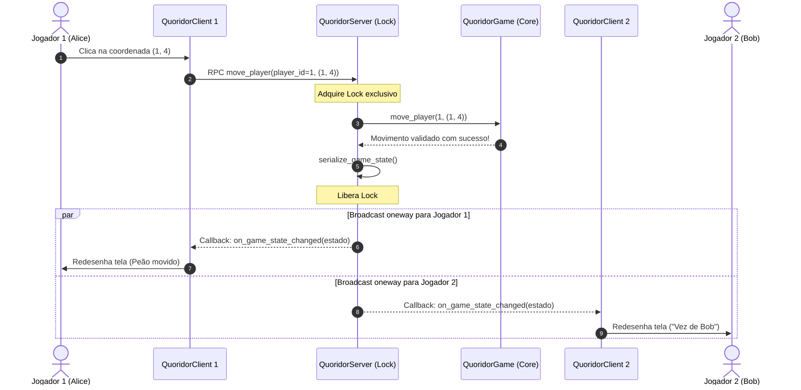

# Guia de Revisão: Arquitetura de Rede e Pyro5 no Quoridor

Este documento apresenta uma revisão conceitual e prática da camada de rede do projeto Quoridor, dividido em duas partes:

1. **Parte 1: Funcionamento Didático do Pyro5** (conceitos essenciais de RPC e objetos distribuídos).
2. **Parte 2: Aplicação Prática no Quoridor** (como o servidor, cliente, callbacks e protocolos foram implementados).

---

## Parte 1: O que é o Pyro5 e como ele funciona (Visão Didática)

### 1. A Analogia do Restaurante e Telefone

Em uma aplicação Python local, quando um objeto executa um método, tudo roda na mesma memória RAM e processador:

```python
jogo = Jogo()
jogo.mover(1, 4)  # Executado diretamente na sua máquina
```

Para transformar esse jogo em multiplayer distribuído (onde jogadores em computadores distintos interagem com o mesmo tabuleiro), é necessário que um computador envie instruções para o outro.

Tradicionalmente, isso exigiria programação com sockets TCP de baixo nível: abrir portas, gerenciar buffers de bytes, empacotar mensagens e tratar falhas de fragmentação.

O **Pyro (Python Remote Objects)** abstrai toda essa complexidade através de **RPC (Remote Procedure Call / Invocação de Método Remoto)**:

* Para o código do cliente, a chamada se parece com uma chamada de método Python comum: `servidor.move_player(...)`.
* Por baixo dos panos, o Pyro intercepta essa invocação, empacota os argumentos, transmite-os via TCP até a máquina remota, executa a função lá dentro e devolve o resultado.

---

### 2. Os Quatro Pilares do Pyro5

A comunicação no Pyro se apoia em quatro componentes fundamentais:

```text
+-------------------------------------------------------------------+
|                        1. Name Server                             |
|       "Lista telefônica" (ex: "quoridor.servidor" -> URI)         |
+-------------------------------------------------------------------+
             ^                                      ^
   Registra  |                                      | Consulta
   ao subir  |                                      | ao conectar
             |                                      |
+---------------------------+        +------------------------------+
| 2. Servidor (Daemon)      |  TCP   | 4. Cliente (Proxy)           |
| Escuta conexões em porta  |<=======| O "dublê" do objeto que      |
| e executa 3. Objeto Remoto|        | recebe chamadas locais       |
+---------------------------+        +------------------------------+
```

#### A. Objeto Remoto (`@Pyro5.api.expose`)

É a classe Python normal que executa a lógica do sistema. Por segurança, o Pyro exige que qualquer classe ou método acessível via rede seja decorado com `@Pyro5.api.expose`. Isso impede que usuários remotos executem funções arbitrárias ou comandos perigosos do sistema.

#### B. Daemon (`Pyro5.api.Daemon`)

Funciona como o "ouvinte" ou "garçom" do servidor:

* Abre um socket TCP em uma porta da máquina.
* Fica escutando requisições em um loop de eventos.
* Ao receber uma requisição de método, localiza a instância do objeto remoto registrado, executa a função com os argumentos recebidos e serializa o retorno de volta para a rede.

#### C. Proxy (`Pyro5.api.Proxy`)

É o "dublê" ou procurador do objeto que reside na máquina do cliente:

* O cliente não tem a instância real do servidor, apenas uma referência de rede (URI).
* Ao chamar `proxy.move_player(pos)`, o Proxy empacota a chamada, envia pela rede ao Daemon, bloqueia temporariamente aguardando a resposta e retorna o valor para a aplicação como se fosse local.

#### D. Name Server (`pyro5-ns`)

Funciona como a "lista telefônica" ou servidor DNS do Pyro:

* Sem o Name Server, o cliente precisaria conhecer previamente o IP e a porta dinâmica exata do objeto remoto (ex: `PYRO:obj_48bf9a@192.168.1.50:58291`).
* Com o Name Server, o servidor publica seu serviço com um nome amigável (ex: `"quoridor.servidor"`). O cliente faz a busca por `PYRONAME:quoridor.servidor` e o Name Server devolve o endereço de conexão correto de forma transparente.

---

### 3. Recursos Avançados Cruciais para Jogos

#### Callbacks Bidirecionais

Em sistemas cliente-servidor tradicionais (como APIs REST), o cliente sempre pergunta e o servidor responde. Porém, em um jogo de tabuleiro com turnos:

* Quando o Jogador 1 move uma peça, o Servidor precisa avisar ativamente o Jogador 2 para que seu tabuleiro seja atualizado.
* No Pyro, isso é resolvido fazendo com que **o próprio cliente também suba um mini-Daemon**. Ao se registrar no servidor, o cliente entrega a sua própria URI de callback. Dessa forma, o servidor cria um Proxy apontando de volta para cada cliente, permitindo mensagens *push* instantâneas.

#### Chamadas Não Bloqueantes (`@Pyro5.api.oneway`)

Normalmente, uma chamada RPC bloqueia quem a chamou até que o destinatário termine o processamento e envie uma resposta.

* Se o servidor fizesse chamadas síncronas para notificar 4 jogadores sobre uma jogada, a lentidão ou lag de um único jogador congelaria o turno de todos os outros.
* Com o decorador `@Pyro5.api.oneway`, o servidor despacha a notificação para o cliente sem esperar confirmação ("fire-and-forget"). O fluxo da partida continua sem atrasos.

#### Modelo de Instância Única (`instance_mode="single"`)

Por padrão, alguns frameworks de RPC instanciam um objeto novo para cada conexão recebida.
Para um jogo multiplayer com estado compartilhado, precisamos garantir que todos os jogadores interajam com a mesma partida. O decorador `@Pyro5.api.behavior(instance_mode="single")` instrui o Pyro a manter uma única instância global do servidor (*Singleton*).

#### Serialização Customizada (Serpent)

O tráfego de dados na rede requer que objetos complexos sejam transformados em sequências de bytes e reconstruídos do outro lado. O Pyro utiliza a biblioteca Serpent. Para classes próprias (como `Wall` e `Player`), registramos conversores que transformam a classe em dicionário e vice-versa.

---

## Parte 2: Utilização Prática no Quoridor

No projeto, a camada de comunicação está concentrada no pacote `network/`:

```text
quoridor/network/
├── config.py     # Configurações globais, serialização Serpent e constantes
├── protocol.py   # Dicionário serializável do estado do jogo (ponte core <-> rede)
├── server.py     # Servidor central Pyro5 com controle de concorrência
└── client.py     # Cliente Pyro5 com Daemon local de callbacks e padrão Observer
```

---

### 1. Configuração e Serialização (`network/config.py`)

A função `configure_pyro()` registra a serialização bidirecional das dataclasses do domínio:

```python
# Serialização da parede (Wall -> dict)
Pyro5.api.register_class_to_dict(
    Wall,
    lambda w: {
        "__class__": "core.models.Wall",
        "position": tuple(w.position),
        "orientation": w.orientation,
    },
)

# Desserialização da parede (dict -> Wall)
Pyro5.api.register_dict_to_class(
    "core.models.Wall",
    lambda _cn, d: Wall(tuple(d["position"]), d["orientation"]),
)
```

Isso garante que `Wall` e `Player` possam ser enviados e recebidos diretamente nos métodos remotos sem conversões manuais espalhadas pelo código.

---

### 2. O Servidor Central (`network/server.py`)

O servidor atua como **autoridade única da partida** (*Authoritative Server*). Nenhuma regra ou movimento é decidido pelo cliente.

#### Concorrência Thread-Safe com `threading.Lock`

Múltiplas chamadas RPC de clientes diferentes chegam em threads concorrentes no servidor. Para evitar condições de corrida (por exemplo, dois jogadores tentarem colocar paredes na mesma ranhura simultaneamente), o servidor protege todas as mutações com `self.lock`:

```python
@Pyro5.api.expose
@Pyro5.api.behavior(instance_mode="single")
class QuoridorServer:
    def __init__(self):
        self.lock = threading.Lock()
        self.game = None
        self.lobby = []
        self.callbacks = {}  # {player_id: callback_uri}
```

#### Broadcast Resiliente e Eliminação por Desconexão

Quando uma ação acontece, o servidor precisa notificar todos os clientes conectados através de `_broadcast()`:

1. O servidor itera sobre o dicionário de callbacks `self.callbacks`.
2. Para cada cliente, cria um `Pyro5.api.Proxy(uri)` com timeout configurado de 3 segundos (`proxy._pyroTimeout = 3.0`).
3. Invoca o método do callback (ex: `on_game_state_changed`).
4. Se ocorrer falha de comunicação (cliente fechou a janela ou caiu a internet), o jogador é inserido na lista `dead_players`.
5. Em seguida, o método `_eliminate_player_unlocked` remove o jogador, atualiza o turno entre os remanescentes e, se restar apenas um jogador ativo, encerra a partida declarando vitória por W.O.

#### Name Server Embutido Automático

A função `start_server()` verifica se já existe um Name Server ativo na rede. Caso não encontre, ela inicializa em background uma thread com `Pyro5.api.start_ns_loop()`. Isso permite iniciar o servidor sem precisar rodar comandos externos adicionais.

---

### 3. O Cliente e o Manipulador de Callbacks (`network/client.py`)

O cliente gerencia a conexão com o servidor e provê os eventos para as interfaces visuais (GUI e CLI).

#### `GameClientCallback` (Recepção de Notificações)

Esta classe é exposta ao Pyro no cliente e contém os métodos que o servidor aciona remotamente. Todos são anotados com `@Pyro5.api.oneway`:

* `on_player_joined(player_info, lobby_players)`: Novo jogador entrou na sala.
* `on_player_left(player_id, lobby_players)`: Jogador desconectou.
* `on_game_started(initial_state)`: A partida começou.
* `on_game_state_changed(game_state, message)`: O tabuleiro foi modificado (movimento, parede ou turno).
* `on_game_over(winner_id, winner_name, game_state)`: Vitória confirmada.
* `on_error(message)`: Notificação de erro.

#### `QuoridorClient` e o Daemon Secundário

No momento da conexão (`client.connect()`):

1. O cliente instancia seu próprio `Pyro5.api.Daemon`.
2. Registra a instância de `GameClientCallback` nesse daemon e obtém sua `callback_uri`.
3. Inicia o loop de atendimento do daemon (`daemon.requestLoop`) em uma **thread secundária de segundo plano (`threading.Thread(daemon=True)`)**. Isso impede que o cliente trave o loop de desenho do Pygame ou do terminal.
4. Conecta-se ao servidor pelo Name Server (`PYRONAME:quoridor.servidor`).
5. Invoca `register_player(player_name, callback_uri)` entregando seu endereço de callback.

#### Integração Desacoplada com a Interface (Observer Pattern)

As interfaces gráficas (`ui/gui.py`) e de console (`ui/cli.py`) não sabem detalhes do Pyro. Elas apenas registram funções ouvintes usando `client.add_listener(meu_callback)`. Quando um evento chega da rede, o `QuoridorClient` o repassa para os ouvintes registrados, que atualizam a tela.

---

### 4. Protocolo e Sincronização (`network/protocol.py`)

Para manter o tráfego de rede leve e desacoplado:

* `serialize_game_state()`: Transforma a instância ativa de `QuoridorGame` e o lobby em um dicionário serializável contendo apenas os dados essenciais (posições dos jogadores, paredes posicionadas, jogador da vez e mensagens de status).
* `sync_game_from_state()`: No lado do cliente, reconstrói ou atualiza uma instância local de `QuoridorGame` a partir do dicionário recebido para que a interface de renderização possa desenhar as posições com precisão.

---

### 5. Diagrama de Sequência de uma Jogada

O diagrama abaixo ilustra o ciclo completo de comunicação quando o Jogador 1 realiza um movimento:



---

## Tabela Resumo para Revisão Rápida

| Conceito / Componente | O que faz no Quoridor | Arquivo Principal |
| --- | --- | --- |
| **RPC (Pyro5)** | Permite chamar métodos remotos como se fossem locais | `network/client.py`, `network/server.py` |
| **Name Server (`pyro5-ns`)** | Resolve nomes amigáveis (`quoridor.servidor`) para endereços de rede | `network/server.py` (`start_server`) |
| **Daemon do Servidor** | Escuta conexões dos jogadores e executa as ações do jogo | `network/server.py` |
| **Daemon do Cliente** | Roda em thread paralela para receber notificações (*callbacks*) | `network/client.py` |
| **`@Pyro5.api.expose`** | Habilita métodos específicos para chamada via rede | `network/server.py`, `network/client.py` |
| **`@Pyro5.api.oneway`** | Envia callbacks sem bloquear o remetente | `network/client.py` (`GameClientCallback`) |
| **`instance_mode="single"`** | Garante que todos os clientes acessem o mesmo estado de partida | `network/server.py` (`QuoridorServer`) |
| **`threading.Lock`** | Evita concorrência e condições de corrida entre jogadas | `network/server.py` |
| **Serpent Serializer** | Converte classes `Wall` e `Player` em dicionários para tráfego TCP | `network/config.py` |
| **Resiliência por Timeout** | Detecta desconexões e aplica vitória por W.O. | `network/server.py` (`_broadcast`) |
