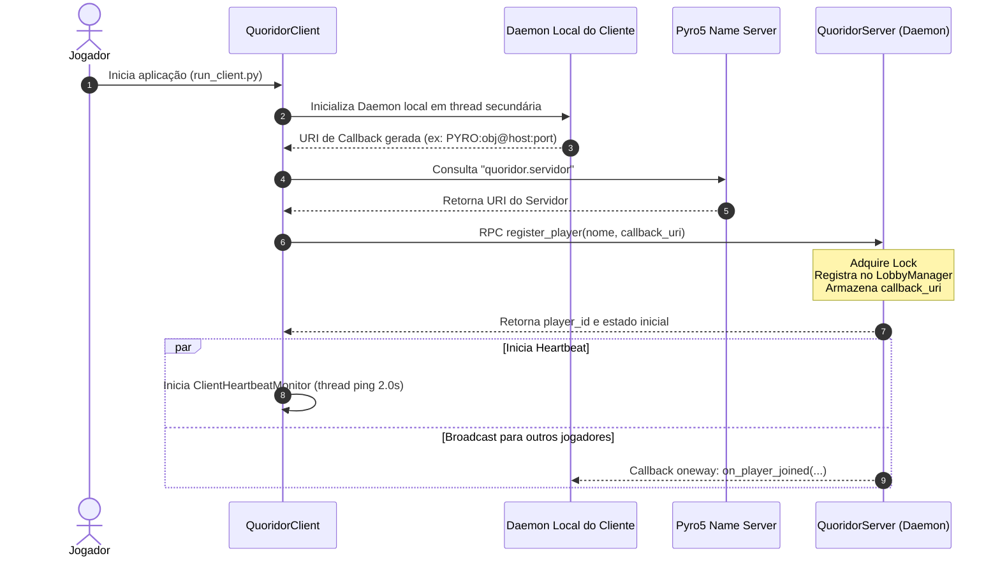
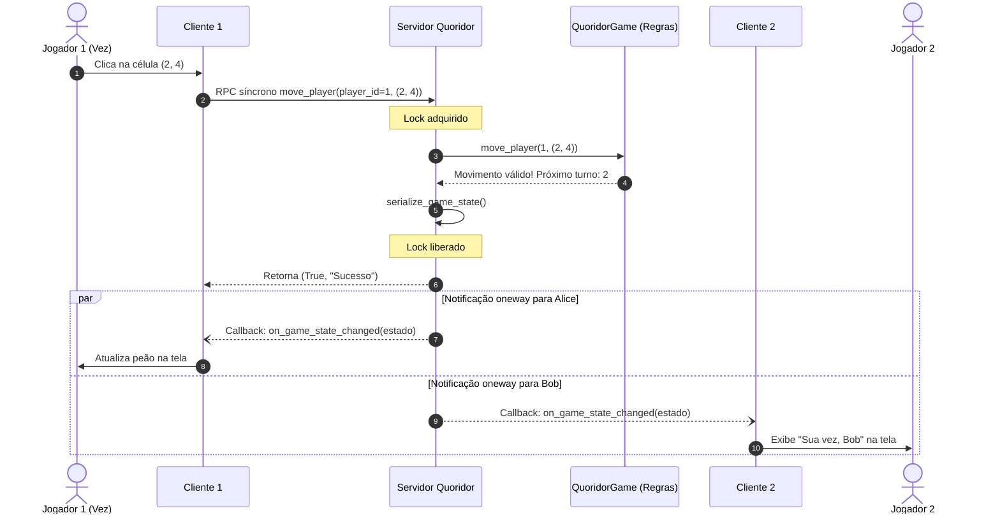
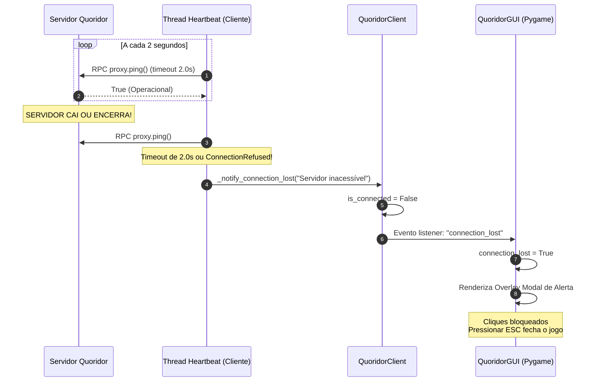

# Guia Teórico e Prático: Sistemas Distribuídos e Pyro5 no Quoridor

Este documento fornece uma visão aprofundada dos conceitos de **Sistemas Distribuídos (SD)** e do framework **Pyro5 (Python Remote Objects)** aplicados no desenvolvimento do Quoridor Multiplayer. Ele foi elaborado para servir tanto como fundamentação teórica quanto como roteiro técnico de apresentação acadêmica.

---

## 1. Visão Geral da Arquitetura Distribuída

O Quoridor Multiplayer implementa uma **Arquitetura Baseada em Objetos Distribuídos** operando sob o modelo **Cliente-Servidor com Callbacks Reversos** (*Two-Way RPC / Distributed Observer*).

```text
┌────────────────────────────────────────────────────────────────────────┐
│                        Pyro5 Name Server                               │
│              Serviço de Nomes / Descoberta Dinâmica                    │
│             Registra: "quoridor.servidor" -> URI de Rede               │
└────────────────────────────────────▲───────────────────────────────────┘
                                     │
                 1. Registra URI     │ 2. Consulta URI
                 ao inicializar      │ ao conectar
                                     │
      ┌──────────────────────────────┴──────────────────────────────┐
      │                                                             │
┌─────┴────────────────────────┐             ┌──────────────────────┴─────┐
│       SERVIDOR PYRO5         │             │       CLIENTE PYRO5        │
│                              │             │                            │
│ ┌──────────────────────────┐ │             │ ┌────────────────────────┐ │
│ │  QuoridorServer          │ │   RPC (TCP) │ │ QuoridorClient         │ │
│ │  (Autoridade Central)    │ │◄────────────┼─┤ (Proxy de Chamadas)    │ │
│ └──────────────────────────┘ │             │ └────────────────────────┘ │
│                              │             │                            │
│ ┌──────────────────────────┐ │  Callbacks  │ ┌────────────────────────┐ │
│ │  Broadcaster             │─┼────────────►│ │ GameClientCallback     │ │
│ │  (Notificações oneway)   │ │  (oneway)   │ │ (Daemon Local)         │ │
│ └──────────────────────────┘ │             │ └────────────────────────┘ │
│                              │             │                            │
│ ┌──────────────────────────┐ │  Heartbeat  │ ┌────────────────────────┐ │
│ │  ping()                  │ │◄────────────┼─┤ ClientHeartbeatMonitor │ │
│ │  (Liveness Probe)        │ │    (ping)   │ │ (Thread de 2.0s)       │ │
│ └──────────────────────────┘ │             │ └────────────────────────┘ │
└──────────────────────────────┘             └────────────────────────────┘
```

### Características Centrais

1. **Servidor Autoritativo (*Authoritative Server*)**: O servidor mantém a única fonte da verdade (*Single Source of Truth*) do estado do jogo (tabuleiro 9x9, peões, paredes, turnos e regras). O cliente não toma decisões de validação de jogadas; ele apenas emite intenções de movimento.
2. **Comunicação Bidirecional por RPC**: Clientes invocam métodos no servidor via RPC síncrono; o servidor notifica clientes via callbacks assíncronos (*push notifications*).
3. **Transparência de Acesso e Localização**: Clientes e servidor interagem com objetos remotos como se fossem locais, resolvendo endereços dinamicamente via serviço de nomes.

---

## 2. Conceitos Fundamentais de Sistemas Distribuídos Aplicados

### 2.1. Invocação de Método Remoto (RPC / RMI)

* **Conceito**: Em vez de gerenciar sockets TCP manuais com envio de buffers de bytes e delimitação de pacotes, a aplicação utiliza **RPC (Remote Procedure Call)**.
* **No Projeto**:
  * Quando um jogador move seu peão, o cliente executa:

    ```python
    sucesso, msg = client.move_player((linha, coluna))
    ```

  * Internamente, o Pyro5 empacota a chamada (*marshalling*), envia pela rede via TCP, aciona o método `QuoridorServer.move_player` na máquina do servidor e devolve a resposta decodificada (*unmarshalling*).

### 2.2. Transparência de Localização e Serviço de Nomes (*Naming Service*)

* **Conceito**: Sistemas distribuídos modernos desacoplam os clientes do conhecimento prévio de endereços IP físicos e portas efêmeras.
* **No Projeto**:
  * O **Pyro5 Name Server (`pyro5-ns`)** atua como um catálogo de diretório (*DNS de objetos*).
  * O servidor se registra com a identificação amigável: `PYRONAME:quoridor.servidor`.
  * Os clientes conectam-se usando unicamente esse identificador lógico. Caso o servidor mude de máquina ou porta, nenhum cliente precisa alterar suas configurações.
  * O projeto inclui inicialização automática de um Name Server embutido (`start_ns_loop`) caso nenhum esteja em execução no ambiente.

### 2.3. Padrão Proxy / Stub e Esqueleto (*Stub/Skeleton Pattern*)

* **Conceito**: A interface entre as camadas locais e a rede é mediada por intermediários.
* **No Projeto**:
  * **Proxy do Cliente (`Pyro5.api.Proxy`)**: Objeto local que implementa a mesma interface do servidor. Quando um método é chamado no proxy, ele serializa a chamada e aguarda o retorno.
  * **Daemon do Servidor (`Pyro5.api.Daemon`)**: O ouvinte TCP que aceita conexões, localiza a instância registrada e executa o método real.

### 2.4. Serialização de Dados (*Marshalling / Serialization*)

* **Conceito**: Estruturas de dados em memória precisam ser convertidas em formatos portáteis de bytes para transmissão por rede e reconstruídas no destino.
* **No Projeto**:
  * O Pyro utiliza o serializador **Serpent** (baseado em literais Python seguros).
  * Em `network/config.py`, registramos serializadores customizados para as entidades do domínio (`Wall` e `Player`):

    ```python
    Pyro5.api.register_class_to_dict(Wall, lambda w: {"position": tuple(w.position), "orientation": w.orientation})
    Pyro5.api.register_dict_to_class("core.models.Wall", lambda _cn, d: Wall(tuple(d["position"]), d["orientation"]))
    ```

  * Isso garante que tipos complexos transitem de forma transparente entre nós da rede.

### 2.5. Concorrência e Regiões Críticas (*Mutual Exclusion*)

* **Conceito**: Em um servidor multithreaded que recebe requisições de múltiplos nós concorrentes, o acesso ao estado compartilhado deve ser sincronizado para evitar condições de corrida (*race conditions*).
* **No Projeto**:
  * O `QuoridorServer` adota o padrão **Singleton de Rede** (`@Pyro5.api.behavior(instance_mode="single")`).
  * Cada chamada de cliente chega em uma thread separada gerida pelo Daemon do Pyro.
  * Todas as operações que leem ou modificam o lobby e o tabuleiro adquirem `self.lock = threading.Lock()`.
  * Isso impede, por exemplo, que dois jogadores coloquem barreiras na mesma ranhura simultaneamente ou que a vez seja alternada incorretamente.

### 2.6. Semânticas de Comunicação: Síncrona vs. Assíncrona (*Oneway RPC*)

* **Conceito**: Chamadas síncronas bloqueiam o chamador até que o receptor responda. Chamadas assíncronas (*fire-and-forget*) liberam o emissor imediatamente após o envio da mensagem no canal.
* **No Projeto**:
  * **Cliente -> Servidor (Síncrono)**: As ações de jogo (`move_player`, `place_wall`, `start_game`) são síncronas porque o jogador precisa saber imediatamente se o movimento foi legal ou rejeitado pelas regras.
  * **Servidor -> Cliente (Assíncrono via `@Pyro5.api.oneway`)**: As notificações de broadcast (`on_game_state_changed`, `on_player_joined`, etc.) são decoradas com `@Pyro5.api.oneway`. O servidor despacha o evento para todos os clientes sem esperar resposta. Isso impede que a lentidão ou lag de um jogador atrase a partida dos outros.

---

## 3. Tolerância a Falhas e Detecção de Quedas

Um dos maiores desafios em Sistemas Distribuídos é lidar com **falhas por parada (*Fail-Stop / Crash Failures*)**. O projeto implementa tolerância a falhas em ambas as pontas:

### 3.1. Detecção e Tratamento de Queda do Cliente (Lado Servidor)

* **Problema**: Um jogador pode fechar a janela, encerrar o processo (Ctrl+C) ou sofrer perda de conexão com a internet durante uma partida.
* **Solução Implementada**:
  1. Durante o broadcast em `Broadcaster.broadcast()`, cada chamada a um cliente remoto utiliza timeout rígido de 3.0s (`proxy._pyroTimeout = 3.0`).
  2. Se a chamada levantar exceção de socket/comunicação, o cliente é marcado na lista de clientes inativos (`dead_players`).
  3. O servidor aciona `_eliminate_player_unlocked`:
     * O jogador caído é desregistrado do lobby e da partida.
     * Se restarem jogadores suficientes, a partida prossegue e o turno avança para o próximo ativo.
     * Se restar apenas **1 jogador**, ele vence imediatamente por **W.O.** (*Walkover*).
     * Se restarem **0 jogadores**, o servidor redefine `self.game = None` e limpa o lobby, evitando bloqueio residual.

### 3.2. Detecção e Tratamento de Queda do Servidor (Lado Cliente)

* **Problema**: Se o servidor cair durante o turno do adversário, o cliente ficaria travado aguardando eventos que nunca chegariam. Se o jogador tentasse clicar no tabuleiro, a thread do Pygame congelaria no Windows esperando resposta.
* **Solução Implementada**:
  1. **Monitor de Heartbeat Ativo (`ClientHeartbeatMonitor`)**:
     * Uma thread em segundo plano realiza ping a cada 2 segundos (`proxy.ping()`).
     * Utiliza um proxy Pyro5 isolado com timeout de 2.0s para não interferir nas chamadas da thread gráfica.
  2. **Detecção Imediata em RPC**:
     * Se qualquer chamada remota (`move_player`, etc.) falhar com erro de comunicação, o evento `"connection_lost"` é disparado na hora.
  3. **Timeout Reduzido para 2.5s**:
     * `self.server_proxy._pyroTimeout` foi reduzido de 10.0s para 2.5s, impedindo que a janela do Pygame congele com o aviso "Não respondendo".
  4. **Overlay Visual Modal**:
     * A GUI escurece a tela e renderiza um aviso elegante: *"CONEXÃO COM O SERVIDOR PERDIDA - Pressione ESC para sair"*.
     * Os cliques no tabuleiro são bloqueados para evitar chamadas de rede travadas.
  5. **Encerramento Gracioso no CLI**:
     * Os loops de espera monitoram `client.is_connected` e encerram graciosamente com aviso no terminal.

### 3.3. Ciclo de Vida e Autorreset do Servidor

* **Problema**: Se os jogadores saírem sem pressionar ENTER para reiniciar, o servidor poderia ficar preso no modo "partida em andamento", recusando novas conexões.
* **Solução Implementada**:
  * Se `not self.lobby.has_active_callbacks()`: o servidor é resetado automaticamente para o estado inicial de espera.
  * Se um novo cliente conectar e a partida anterior já tiver um vencedor (`self.game.winner is not None`): o servidor reseta a partida concluída e recebe os jogadores no lobby.

---

## 4. Diagramas de Sequência e Interação

### 4.1. Conexão do Cliente e Registro de Callbacks



### 4.2. Fluxo de Jogada e Notificação de Turno



### 4.3. Detecção de Queda do Servidor via Heartbeat



---

## 5. Tabela Resumo: Conceitos Teóricos x Implementação

| Conceito de Sistemas Distribuídos | Papel no Projeto Quoridor | Implementação no Código |
| :--- | :--- | :--- |
| **RPC / RMI** | Comunicação cliente-servidor sem gerenciamento manual de sockets | `Pyro5.api.Proxy` e chamadas `_call_remote` |
| **Serviço de Nomes (*Naming Service*)** | Resolução dinâmica de nomes amigáveis para URIs de rede | `Pyro5.api.locate_ns` e `ns.register("quoridor.servidor")` |
| **Publisher-Subscriber / Observer** | Notificações em tempo real sobre jogadas e entradas de jogadores | `GameClientCallback` e `Broadcaster.broadcast()` |
| **Chamadas Assíncronas (*Oneway*)** | Evita que clientes lentos congelem o processamento do servidor | Anotação `@Pyro5.api.oneway` em todos os callbacks |
| **Exclusão Mútua (*Mutex Lock*)** | Sincroniza concorrência de múltiplos clientes no servidor único | `threading.Lock()` envolvendo o estado em `QuoridorServer` |
| **Singleton de Rede** | Garante que todos os clientes compartilhem a mesma partida | `@Pyro5.api.behavior(instance_mode="single")` |
| **Serialização / Marshalling** | Empacotamento de dataclasses em estruturas portáteis de rede | Serializadores Serpent em `network/config.py` |
| **Detecção Ativa (*Heartbeat / Probe*)** | Monitora a saúde do servidor a cada 2s para evitar telas congeladas | `ClientHeartbeatMonitor` em `network/heartbeat.py` |
| **Tolerância a Falhas (*Fail-Stop*)** | Purga clientes mortos e declara vitória por W.O. sem travar partida | Detecção em `Broadcaster` e eliminação no servidor |
| **Separação de Preocupações (SoC)** | Desacopla regras de jogo, I/O de rede e interface gráfica | Módulos `core/`, `network/` e `ui/` |
